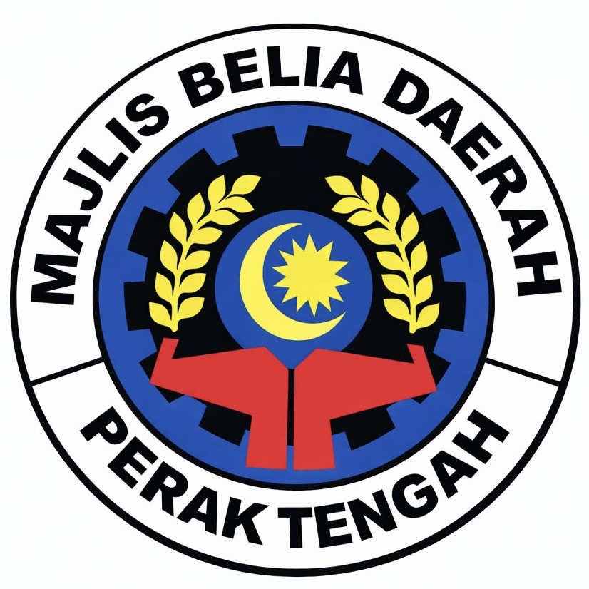

<html lang="ms">
<head>
<meta charset="UTF-8">
<meta name="viewport" content="width=device-width, initial-scale=1.0">
<title>WARISAN MINDA | Majlis Belia Daerah Perak Tengah</title>
<link href="https://fonts.googleapis.com/css2?family=Plus+Jakarta+Sans:wght@400;500;600;700;800&display=swap" rel="stylesheet">

</head>

<body>

<header>
 

  
  

   
WARISAN MINDA

   
MAJLIS BELIA DAERAH PERAK TENGAH

  

 

 <button class="secondary" onclick="bukaAdminModal()">ADMIN</button>
</header>

<!-- HALAMAN UTAMA -->
<section id="home">
 

  
  
EDISI KHAS 36 SET SOALAN • NEGERI PERAK

  <h1>WARISAN MINDA</h1>
  <h3>SEJARAH NEGERI PERAK, MALAYSIA & SUKAN TRADISIONAL</h3>
  
Uji kefahaman anda mengenai khazanah sejarah Negeri Perak, tokoh perjuangan kemerdekaan dan keunikan warisan budaya tanah air.

  

   <button class="primary" onclick="showRegister()">MULA CABARAN KUIZ →</button>
   <button class="secondary" onclick="showLeaderboard()">🏆 PAPAN MARKAH</button>
  

 

 

  <h2>📋 Format & Struktur Pemarkahan</h2>
  

   
8 SoalanRawak daripada 36 soalan

   
3 Mudah10 markah setiap soalan

   
3 Sederhana20 markah setiap soalan

   
2 Sukar30 markah setiap soalan

  

  
Markah penuh ialah <strong>150 markah</strong>. Sijil digital dijana selepas kuiz tamat.

 

</section>

<!-- PENDAFTARAN -->
<section id="register" class="hidden">
 

  <h2>📝 Pendaftaran Peserta</h2>

  <label>Nama Penuh Peserta *</label>
  <input id="nama" maxlength="120" placeholder="Masukkan nama penuh untuk sijil">

  

   

    <label>Umur</label>
    <input id="umur" type="number" min="1" max="120" placeholder="Contoh: 16">
   

   

    <label>Tempat Tinggal</label>
    <input id="daerah" maxlength="100" placeholder="Seri Iskandar / Parit">
   

  

  <label>Mod Cabaran Kuiz</label>
  <select id="mod">
   <option value="santai">Mod Santai (Tiada had masa)</option>
   <option value="pertandingan">Mod Pertandingan (30 saat setiap soalan)</option>
  </select>

  

   <button class="primary" style="flex:2" onclick="mulaKuiz()">MULA MENJAWAB →</button>
   <button class="outline" style="flex:1" onclick="home()">KEMBALI</button>
  

 

</section>

<!-- KUIZ -->
<section id="quiz" class="hidden">
 

  

   
   
  

  

  

  

  

  

   <button class="primary" id="next" onclick="seterusnya()" disabled>SETERUSNYA →</button>
  

 

</section>

<!-- KEPUTUSAN -->
<section id="result" class="hidden">
 

  KEPUTUSAN RASMI

  

   0
   DARIPADA 150
  

  <h2 id="namaKeputusan" style="justify-content:center;margin-bottom:5px"></h2>
  <h3 id="pencapaian" style="color:var(--blue);margin-bottom:14px"></h3>

  

   
   
  

  

   <button class="primary" onclick="sijil()">🖨️ CETAK SIJIL DIGITAL</button>
   <button class="secondary" onclick="showLeaderboard()">🏆 LEADERBOARD</button>
   <button class="outline" onclick="home()">HALAMAN UTAMA</button>
  

 

 

  <h2>📖 Semakan Jawapan & Fakta Warisan</h2>
  

 

</section>

<!-- LEADERBOARD -->
<section id="leaderboard" class="hidden">
 

  <h2>🏆 Papan Markah Tertinggi</h2>
  

   <table>
    <thead>
     <tr>
      <th>Kedudukan</th>
      <th>Nama Peserta</th>
      <th>Tempat Tinggal</th>
      <th>Markah</th>
     </tr>
    </thead>
    <tbody id="ranking"></tbody>
   </table>
  

   
  <button class="outline" onclick="home()">← KEMBALI KE UTAMA</button>
 

</section>

<!-- ADMIN -->
<section id="admin" class="hidden">
 

  <h2>⚙️ Papan Pemuka Admin</h2>

  

   
0Jumlah Penyertaan

   
0.0Purata Markah

   
0Markah Tertinggi

  

  

   <button class="primary" onclick="exportCSV()">📥 MUAT TURUN REKOD CSV</button>
   <button class="danger" onclick="sahkanPadamRekod()">🗑️ PADAM SEMUA REKOD</button>
   <button class="outline" onclick="home()">KELUAR ADMIN</button>
  

  
Nota: Rekod disimpan dalam storan pelayar pada peranti ini sahaja.

 

</section>

<!-- SIJIL -->
<section id="certificateView" class="hidden">

 

  <button class="outline" onclick="paparan('result')">← KEMBALI KE KEPUTUSAN</button>
  <button class="primary" onclick="window.print()">🖨️ CETAK / SIMPAN PDF</button>
 

 

  

  
MAJLIS BELIA DAERAH PERAK TENGAH

  
SIJIL PENYERTAAN

  
Dengan sukacitanya diperakui bahawa

  
NAMA PESERTA

  
telah berjaya menyertai dan menamatkan Cabaran Kuiz Interaktif

  <h3 style="color:#0f172a;margin:10px 0;font-size:16px">
   WARISAN MINDA: SEJARAH NEGERI PERAK & SUKAN TRADISIONAL
  </h3>

  
Pencapaian Markah: 0/150

  

   Tarikh Dikeluarkan: -
  

  

   
   

   
MEGAT MUHAMMAD JAMIL BIN MEGAT AZAHAR

   

    PENGERUSI 
    MAJLIS BELIA DAERAH PERAK TENGAH
   

  

 

</section>

<!-- MODAL -->

 

  
Makluman

  

  

   <input type="password" id="modalInput" placeholder="Masukkan kata laluan..."
    onkeydown="if(event.key==='Enter')semakKataLaluanAdmin()">
  

  

 

<footer>
 <strong>WARISAN MINDA © 2026</strong> • Majlis Belia Daerah Perak Tengah 
 Memperkasa Jati Diri Belia Melalui Sejarah & Warisan Negeri Perak
</footer>

</body>
</html>
